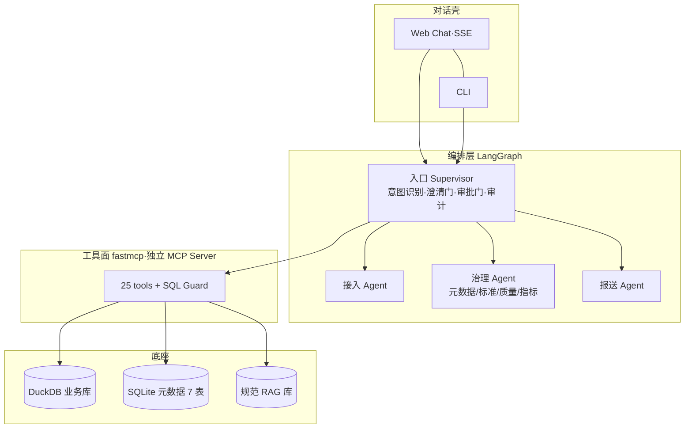

# 🤖 DGA · Data Governance Agent

> **像 ChatGPT 一样，用对话完成数据接入 → 数据治理 → 数据报送。**
> Talk to your data platform: ingest, govern, and report — all in one conversation.

[English intro below](#-dga-in-english)

## 这是什么

DGA 是一个开源的数据治理 Agent：不写 SQL、不配界面、不填表单，所有动作在对话框里完成。

```text
你: 连一下 demo 库，看看有什么表
DGA: 📋 发现 8 张表（客户/账户/交易/产品...）⚠️ ods_customer 12 字段无注释，2 个疑似 PII
你: 检查 ods_customer 的落标情况
DGA: 贯标率 60%。未贯标 5 字段：cert_type → 推荐 STD-C-002（证件类型，置信度 0.91）...
你: 按 STD-C-002 给 cert_type 贯标
DGA: ┌─【变更计划卡 #p77】动作/对象/变更/回滚 ─┐  [✅确认] [❌取消]
你: 确认
DGA: ✅ 已贯标 · 审计号 #a1f3 · ➡️ 建议重新跑落标检查
```

## 架构



三层铁律：`壳 → 编排 → 工具 → 数据` 单向依赖。**工具面是独立 MCP Server，可被 Claude Code / ZCode 等直接挂载**（见下）。

## 快速开始

```bash
pip install -e ".[demo]"
python demo/build_demo.py        # 生成 demo/bank_retail.duckdb + demo/meta.db（约 3 秒）
uvicorn dga.server:app --reload  # Web 对话 http://127.0.0.1:8000
# 或 CLI
dga chat
# 或把 DGA 工具面挂进你的 coding agent
dga mcp
```

> demo 数据全部自编（模拟银行零售场景 8 表 / 20 条数据标准 / 15 个指标 / 10 条 ETL 血缘 / 3 篇模拟报送规范），不含任何真实机构数据与监管制度原文。

## 与生态的对比

| | DataHub skills | OpenMetadata ai-sdk | dq-copilot | altimate-code | **DGA** |
|---|---|---|---|---|---|
| 形态 | Agent Skills | SDK/MCP 工具面 | 质量平台(Alpha) | 数据工程 TUI | **独立对话产品** |
| 元数据 | ✅需DataHub | ✅需OM | ➖ | ➖ | ✅自带 |
| 数据质量 | 诊断侧 | 商业版 | ✅✅ | SQL反模式 | ✅ |
| 标准/落标 | ❌ | ❌ | ❌ | ❌ | ✅ |
| 指标口径 | ❌ | ❌ | ❌ | ❌ | ✅ diff+血缘 |
| 报送映射 | ❌ | ❌ | ❌ | ❌ | ✅ |

（对比基于 2026-10 开源版本调研，详见项目 docs/landscape.md）

## Roadmap

- **v0.1** 单链对话跑通 6 个 P0 场景（探查/落标/质量/口径/规范问答）
- **v0.2** 三子 Agent 路由 + 审批门 + 审计日志
- **v0.3** 评测集（deepeval 50 问）+ 双语 README + 正式发布

**Non-Goals（v1 前不做）**：多租户/权限体系、调度执行（只生成配置）、管理界面、图数据库、真实监管制度。

## License

Apache-2.0. AI-assisted contributions follow the policy in [AGENTS.md](AGENTS.md).

---

# 🤖 DGA in English

DGA is an open-source conversational data governance agent: **ingest, govern, and report on your data — all in one chat**. It ships with a self-contained mock bank retail dataset (8 tables, 20 data standards, 15 metrics with lineage, 3 mock regulatory specs), an approval gate for every write operation, an append-only audit log, and a SQL guard that hard-blocks destructive statements. Its tool layer is a standalone MCP server, so you can also mount DGA directly into Claude Code or any MCP client.

```bash
pip install -e ".[demo]" && python demo/build_demo.py && uvicorn dga.server:app --reload
```

Roadmap: v0.1 single-chain chat over 6 core scenarios → v0.2 sub-agent routing + approval gate → v0.3 eval suite + release.
